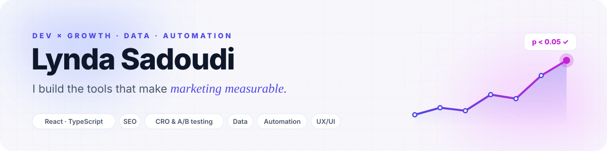

<picture>
  <source media="(prefers-color-scheme: dark)" srcset="assets/banner-dark.svg">
  
</picture>

  
  
  

### Hi, I'm Lynda 👋

I work where **code**, **growth marketing** and **data** meet.
I studied applied mathematics, then UX/UI design, then full-stack development (Ironhack) and a Master's in digital marketing — so my favourite problems are the ones where a landing page, a tracking plan and a statistical test all matter.

- 📈 **Growth Marketer & SEO** at Elara Beautyyi — technical & semantic SEO on Shopify, conversion-focused A/B tests
- 🌸 **Founder of SoftSeoul** — a K-beauty brand built on education-first content
- 🛠️ On GitHub I build **the tools I wish I had**: SEO audits, A/B test statistics, clean tracking, automated KPI reports
- 🧭 My method: **Clarity → Trust → Desire → Action**
- 🌍 French (native) · English (B2)

---

### 🧩 What I do

| 💻 Dev | 📈 Growth & SEO | 📊 Data | ⚙️ Automation | 🎨 UX/UI |
|:--|:--|:--|:--|:--|
| React · TypeScript Tailwind · Node.js MERN · Vite | Technical SEO · Shopify CRO · A/B testing GA4 · Google Ads | pandas · KPIs Cohorts & LTV Statistics | GitHub Actions Data pipelines CLIs | Figma · Design systems UX writing Prototyping |

---

### 🚀 Featured projects

| Project | What it does | Stack |
|:--|:--|:--|
| 🔎 **[seo-audit-toolkit](https://github.com/lindasad3/seo-audit-toolkit)** | CLI & GitHub Action auditing 31 on-page SEO rules (meta, headings, JSON-LD, links…) with a weighted score — fails CI when SEO regresses. [Demo report](https://lindasad3.github.io/seo-audit-toolkit/) | Node.js · Cheerio · GitHub Actions |
| 📊 **[ab-test-calculator](https://github.com/lindasad3/ab-test-calculator)** | Significance, Bayesian P(B > A), sample-ratio-mismatch check and sample-size planning. Stats coded from scratch, tested against SciPy. [Live app](https://lindasad3.github.io/ab-test-calculator/) | React · TypeScript · Vitest |
| 📈 **[growth-metrics-pipeline](https://github.com/lindasad3/growth-metrics-pipeline)** | Weekly automated pipeline: data-quality gate → MER, CAC, ROAS, funnel, cohorts → anomaly detection → dashboard. [Live dashboard](https://lindasad3.github.io/growth-metrics-pipeline/) | Python · pandas · pytest · Actions |
| 🔗 **[utm-builder](https://github.com/lindasad3/utm-builder)** | Clean UTM links with naming conventions, **GA4 channel prediction**, bulk mode, QR codes and CSV export. [Live app](https://lindasad3.github.io/utm-builder/) | React · TypeScript · GA4 |
| 🛍️ **[shopify-seo-snippets](https://github.com/lindasad3/shopify-seo-snippets)** | Drop-in Liquid snippets: smart robots rules, Open Graph, Product/Breadcrumb/FAQ JSON-LD — render-tested and Theme Check-clean. | Shopify Liquid · liquidjs |

<b>Client & product work</b>

 

| Project | Description | Links |
|:--|:--|:--|
| 🏗️ **Entreprise AZ** | Conversion-focused website for a renovation company: reassurance-first UX, GSAP hero, multi-page. | [Code](https://github.com/lindasad3/Construction-Company-Website) · [Live](https://renovation-az.netlify.app) · [v1](https://github.com/lindasad3/entreprise-az) |
| 🎬 **CinéFlow** | Persona-driven movie-watch app: personalised feed, release agenda, watchlist, quiet-hours notifications. | [Code](https://github.com/lindasad3/cineflow) · [Live](https://lindasad3.github.io/cineflow/) |
| ✨ **lynda.dev** | My bilingual portfolio: case studies for SoftSeoul, Kuramono and ColorPoint. | [Code](https://github.com/lindasad3/lynda.dev) · [Live](https://lindasad3.github.io/lynda.dev/) |

---

### 🛠️ Toolbox

 

---

### 🧭 Path

| When | Role | Where |
|:--|:--|:--|
| 2026 → now | Growth Marketer & SEO | Elara Beautyyi |
| 2024 → now | Founder & E-commerce Manager | SoftSeoul |
| 2025 | UI/UX Designer — AI generative-art platform | Kuramono · Berlin |
| 2024 | Webmaster & local SEO consultant | Entreprise AZ |
| 2023 | Graphic Designer | Color Point · Istanbul |

**Education** — Master *Responsable Marketing Digital* (Nexa Digital School) · Web Development Bootcamp MERN (Ironhack Paris) · Bachelor 2 Graphic Design & UX/UI (L'École Multimédia) · L2 Applied Mathematics (Université Paris Cité)

---

🇫🇷 <b>En français</b>

 

Je travaille à l'intersection du **code**, du **growth marketing** et de la **data**. Formée en mathématiques appliquées, en design UX/UI, en développement web (Ironhack) puis en marketing digital (Master), j'aime les sujets où une landing page, un plan de tracking et un test statistique comptent autant.

Aujourd'hui **Growth Marketer & SEO** chez Elara Beautyyi (Shopify) et **fondatrice de SoftSeoul**, je construis sur GitHub les outils qui rendent le marketing mesurable : audit SEO automatisé, calculateur de tests A/B, liens UTM propres, snippets SEO Shopify et pipeline de KPI automatisé.

📫 Ouverte aux échanges autour du growth, du SEO technique, de la data marketing et de l'automatisation — [LinkedIn](https://www.linkedin.com/in/lynda-sadoudi-66008a167/) · [lynda.sadoudi2@gmail.com](mailto:lynda.sadoudi2@gmail.com)

  <picture>
    <source media="(prefers-color-scheme: dark)" srcset="https://raw.githubusercontent.com/lindasad3/lindasad3/output/snake-dark.svg">
    
  </picture>

